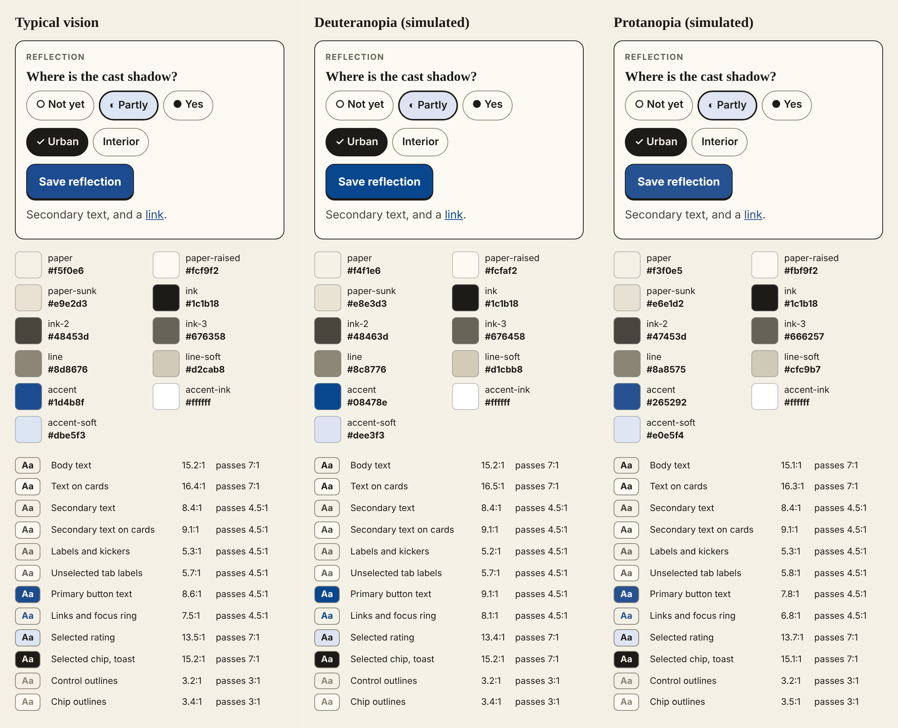
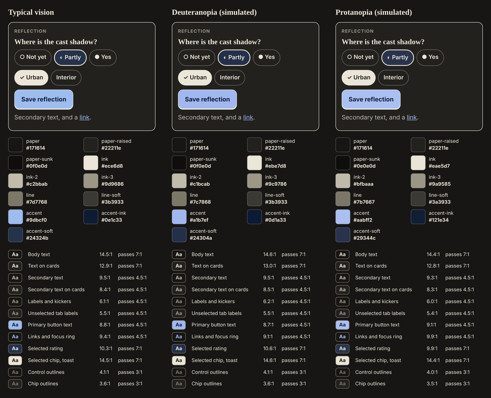

# Design

Sketchbook Coach is used standing up, one-handed, often with a coffee in the other hand, by someone who is red-green colorblind. Each principle below is tied to a specific decision in the app, and to where it lives in the code.

## Fitts's law and one-handed use

| Decision | Where |
| --- | --- |
| **Capture is one tap from launch.** The raised centre button in the tab bar *is* a file input with `capture="environment"`, so the tap opens the rear camera directly. There is no intermediate screen. | `TabBar` in `src/App.tsx` |
| The Capture disc is 68 pt across, the largest target in the app, in the bottom-centre of the screen where either thumb reaches. | `.capture-disc` |
| Every button, chip, tab and checkbox row is at least 48 pt tall (`--tap: max(48px, 3rem)`), and grows with the text size. An e2e test measures every control on every main screen. | `tokens.css`, `e2e/practice.spec.ts` |
| Primary actions sit in a bar pinned to the bottom: Save to journal, Save reflection, Start drawing, Done · rate it, Start poses. | `Screen` `actions` |
| Focused flows also get a Back button in that bottom bar, so nobody has to reach the top-left corner. | `Screen` `back` |
| Photos sit at the top of a screen and their controls below them, so the thumb never covers what it is adjusting. | `ValueTools` |
| Crop handles have 48 pt hit areas around an 18 pt visible dot. | `.crop-handle` |

## Hick's law and cognitive load

| Decision | Where |
| --- | --- |
| Four tabs plus Capture. | `TABS` |
| One primary (filled blue) button per screen. Everything else is outlined or underlined. | `.btn-primary` |
| The Journal shows at most **one** notice at a time, in priority order: monthly review, then backup reminder, then baseline prompt. | `Notice` in `Journal.tsx` |
| Progressive disclosure: date, baseline flag and project link are behind **More** on the capture screen; "stretch to the photo's range" is behind **More** in the value tools; the full list of ten weaknesses is behind **Show all ten**; pairs that are close for anyone are collapsed in the Palette Lab. | `Capture.tsx`, `ValueTools.tsx`, `EntryFields.tsx`, `PaletteLab.tsx` |
| Sheets never stack. Where a sheet leads to another (More → Edit details → Delete), the first closes before the second opens. | `Sheet`, `EntryDetail.tsx` |
| Focused flows (capture, reflection, plan, a drill, the gesture timer, monthly review, swatch sampling) hide the tab bar and show only their own action. | `FLOWS` |
| Today's practice proposes one to three drills, not a library to choose from. | `proposePractice` |

## Recognition over recall

| Decision | Where |
| --- | --- |
| Subject, medium, minutes, feeling word, location and weakness are all chips. The two text fields are optional extras under the chips. | `EntryFields.tsx` |
| Location and feeling chips are his own most recent values first, topped up with starters ("135th St B/C Station", "On the train"). | `recentValues` |
| The date is today, the subject and medium are whatever he used last, and a plan made before drawing pre-fills the feeling word. | `Capture.tsx` |
| Subjects are icon-plus-label tiles. Entries are thumbnails. Then/Now and the monthly review are chosen by tapping pictures. | `EntryThumb` |
| Every drill card says why it is on today's list: New, Due today, Due 6d ago, Your focus. | `dueLabel` |

## Chunking and Gestalt

| Decision | Where |
| --- | --- |
| Related controls share a bordered card (proximity plus common region): each plan step, each recipe, each reflection prompt with its rating and note. | `.card` |
| The timeline is chunked by month with a count; the drill library by what each drill fixes. | `groupByMonth`, `DrillLibrary` |
| Skill trends are small multiples: ten identical small charts in a 2-column grid rather than one chart with ten lines. | `Progress.tsx` |
| A drill reads in a fixed order: why, what it fixes, the success criterion, steps, difficulty, timer. | `DrillDetail` |

## Never color alone

The user confuses reds, greens, browns and oranges. Blues and yellows are reliable. So:

- **The palette is ink on paper with one accent.** Warm off-white, near-black, and an ultramarine blue. No red, no green, no orange anywhere in the interface. There is no success/error color pair at all: confirmation is a dark toast with words in it.
- **Every state has a shape or a word.** Selected chips invert to solid ink and gain a tick. The selected tab gets a heavier icon, darker label and an ink bar. Ratings are an empty, half-filled or solid circle with "Not yet / Partly / Yes" written under it. Baselines carry a flag icon and the word. Drawn days are solid squares with a dot. Difficulty is filled squares. Drill outcomes are an arrow and a word.
- **Charts use position and markers.** In skill trends, height carries the rating and the marker repeats it (hollow, ringed, solid). The running average is a dashed line. The chart is drawn in one ink color.
- **The color tools translate hue into things he can trust.** A sampled color is reported as a plain name, warm/cool/neutral with an icon, a value from 1 to 10 on a labeled grey scale, and the nearest of his own labeled paints. Paints always appear with their name, a temperature tag and a grayscale strip beside the color strip.

### The palette, simulated

`npm run simulate` reads `src/styles/tokens.css`, applies the Machado et al. (2009) matrices, and renders this. It exits non-zero if any pair fails. The same checks run as unit tests (`tests/unit/tokens.test.ts`), which also assert that every non-accent token is a low-chroma neutral, that the accent's hue angle is in the blue range, and that the accent barely moves under simulation (CIEDE2000 under 8).




| Token | Light | Dark | Job |
| --- | --- | --- | --- |
| `--paper` | `#f5f0e6` | `#171614` | Page |
| `--paper-raised` | `#fcf9f2` | `#22211e` | Cards, bars |
| `--paper-sunk` | `#e9e2d3` | `#0f0e0d` | Photo wells |
| `--ink` | `#1c1b18` | `#ece6d8` | Text, borders, selected state |
| `--ink-2` | `#48453d` | `#c2bbab` | Secondary text |
| `--ink-3` | `#676358` | `#9d9686` | Labels |
| `--line` | `#8d8676` | `#7d7768` | Control outlines (3:1) |
| `--accent` | `#1d4b8f` | `#9dbcf0` | The one primary action, links, focus |
| `--accent-soft` | `#dbe5f3` | `#24324b` | Selected rating background |

## Aesthetic-usability

It should feel like a well-made field notebook.

- A faint paper-grain tile (two 128 px PNGs, one per theme, generated by `npm run icons`) sits under everything. It is a static background image, so it costs nothing while scrolling.
- Headings are set in a book serif (Iowan Old Style / Palatino), body in the system sans. Feeling words and margin notes use a hand face. All of it is system fonts, so nothing is downloaded.
- Dividers are an SVG path with a slight wobble, not a CSS border.
- Borders are 1.5 px ink lines; the primary button has a hard 2 px ink shadow like a rubber stamp, not a soft glow.
- Motion is limited to a 120 ms press-down on buttons and a short sheet slide. `prefers-reduced-motion` removes all of it.

## Learning science

| Principle | What the app does | Where |
| --- | --- | --- |
| **Spaced repetition** | Each drill has an interval that expands when he rates it "right" or "easier" (2 days, 5, then × ease) and collapses to tomorrow on "harder". Capped at 60 days. | `src/lib/srs.ts` |
| **Interleaving** | Today's practice never repeats a weakness and reorders so two drills of the same kind (ink, watercolor, gesture) are not back to back. | `proposePractice`, `interleave` |
| **Retrieval practice** | The reflection asks him to answer from memory of the drawing ("Where is the cast shadow?") before looking, instead of showing tips to re-read. The wording rotates each time a weakness comes up. | `Reflect.tsx`, `chooseReflectionPrompts` |
| **Deliberate practice** | Every drill names the one weakness it fixes and has an "It worked if…" criterion that can be checked, often with the app's own value map. | `src/data/drills.ts` |
| **Desirable difficulty** | Three difficulty levels per drill. Three "right" in a row, or one "easier", moves up a level; "harder" moves down. | `reviewDrill` |
| **Implementation intentions** | "When I'm on the train, I'll do one 2-minute gesture." Built from cue and action chips on the Practice tab. | `Practice.tsx` |

## Self-determination

- **Autonomy.** He chooses focus areas and subjects. Practice is introduced as "Suggestions, not orders." Reflection, the plan, the monthly review and onboarding can all be skipped, and the skip is an ordinary button, not a guilt trip.
- **Competence.** Skill trends come from his own ratings and say plainly "Lately: partly, rising." Then/Now puts a baseline beside the latest sketch of the same subject.
- **No guilt.** "Days drawn this month", not a streak. The caption under the month grid says a missed day costs nothing. No badges, no red dots, no push notifications. The backup reminder can be postponed a week.

## Growth-mindset framing

Baseline copy is matter-of-fact: *"Rough is the point. This is your 'before.'"* It appears in onboarding, in the one-time Journal prompt, on the capture screen's baseline checkbox and on the Then/Now screen. "Not yet" is the lowest rating, and the reflection screen says it is "information, not a grade."

## Accessibility

- All sizes are in `rem`/`em`. The root follows iOS Dynamic Type (`font: -apple-system-body`), and Settings adds four text sizes on top. An e2e test loads every main screen at the largest size in both themes and fails on any horizontal overflow.
- Every control has an accessible name; decorative icons are `aria-hidden`; canvases have `role="img"` and a label that describes the current view. Chips expose `aria-pressed`, segmented controls and ratings are radio groups, the toast is a polite live region, sheets are modal dialogs that return focus.
- Contrast is at least WCAG AA for every pair in use, and AAA (7:1) for body text, in both themes and under both simulations.
- Inputs are 16 px or larger so Safari does not zoom on focus.

## Information architecture

```
Journal ── entry ── reflection
   │         └── Then / Now
Practice ── drill ── (photo, rating)
   │   ├── drill library
   │   ├── gesture timer
   │   ├── plan a sketch
   │   └── projects ── project
[ Capture ] ── quick entry ── reflection
See ── live value camera ── freeze and identify
   │   ├── tools on a photo
   │   └── Palette Lab ── sample swatches
Progress ── monthly review
       ├── materials notes
       └── settings and backup
```

This is the arrangement from the brief, unchanged: four tabs and a centre Capture action. The one addition is that focused flows drop the tab bar (see Hick's law above).
