# Sketchbook Coach

A personal drawing-practice notebook for one pen-and-ink sketcher. It runs on an iPhone as an installed web app, fully offline, with no account and no server.

It does four jobs:

1. **Journal.** Photograph each sketchbook page. It is dated, tagged in a few taps, and filed by month.
2. **See.** Value tools built for a red-green colorblind artist: true grayscale, 2/3/5-value maps, squint, a passerby view, mirror flip, sketch-versus-scene comparison, and a color identifier that answers "warm or cool? light or dark?" instead of naming a hue and leaving it there. They work on a saved photo and on the live camera.
3. **Reflect.** After each sketch, three or four questions drawn from ten recurring weaknesses, answered "not yet / partly / yes". The answers become honest trend charts.
4. **Practice.** A drill library on a spaced, interleaved schedule, a gesture timer, a 30-second pre-drawing plan, and multi-page projects built around a feeling word.

| Journal | Value map | Color identifier | Reflection |
| --- | --- | --- | --- |
| 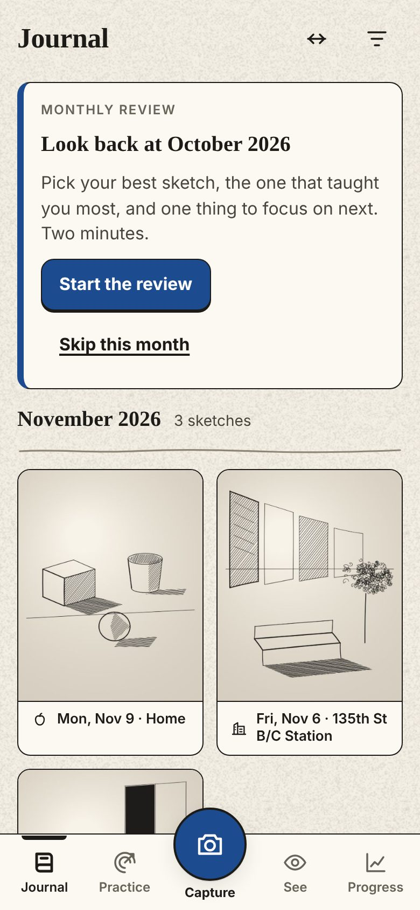 | 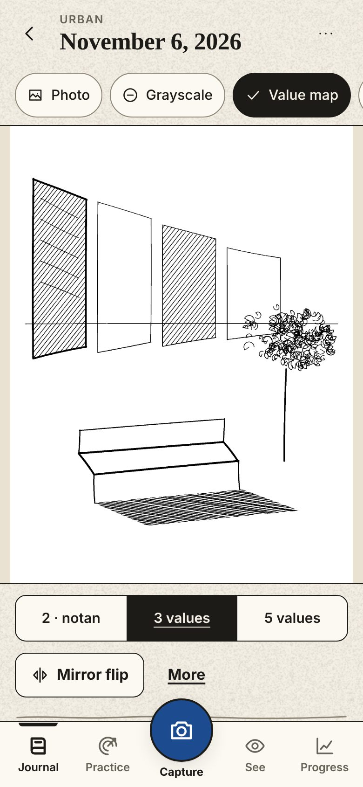 | 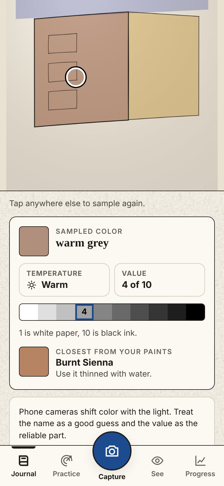 |  |

| Practice | Drill | Plan a sketch | Palette Lab |
| --- | --- | --- | --- |
| 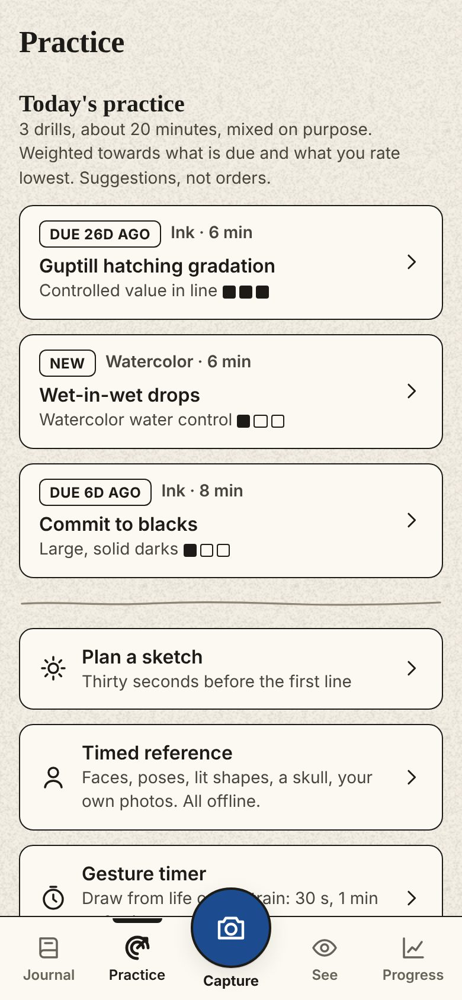 | 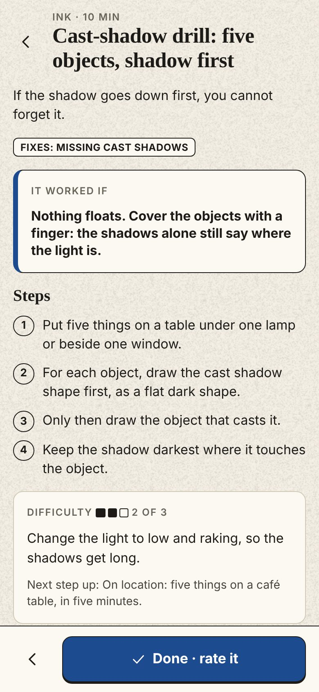 | 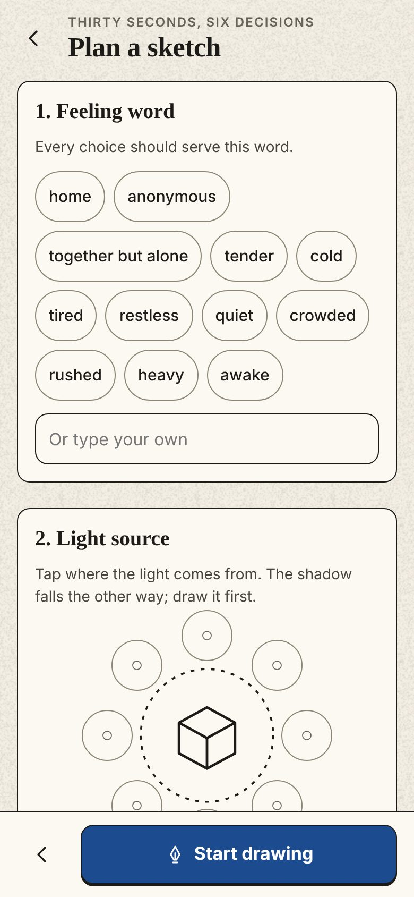 | 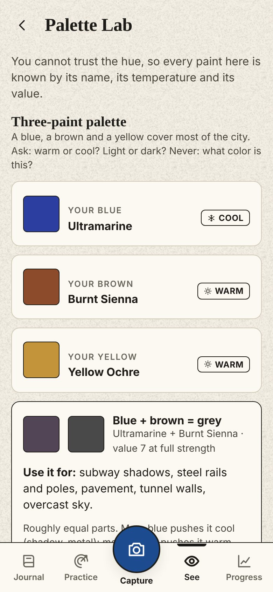 |

| Progress | Then / Now | Journal (dark) | Value map (dark) |
| --- | --- | --- | --- |
| 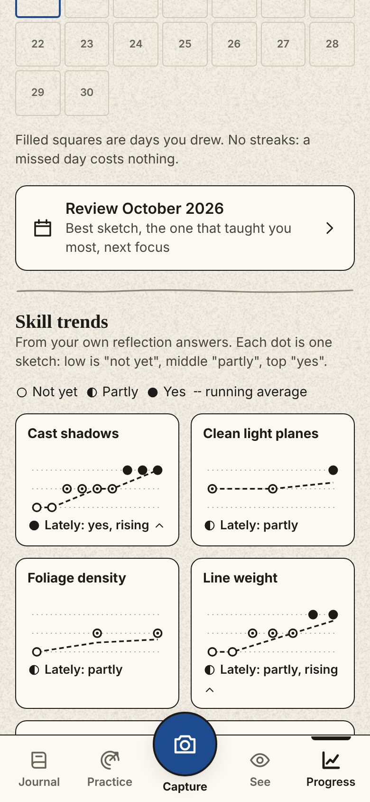 | 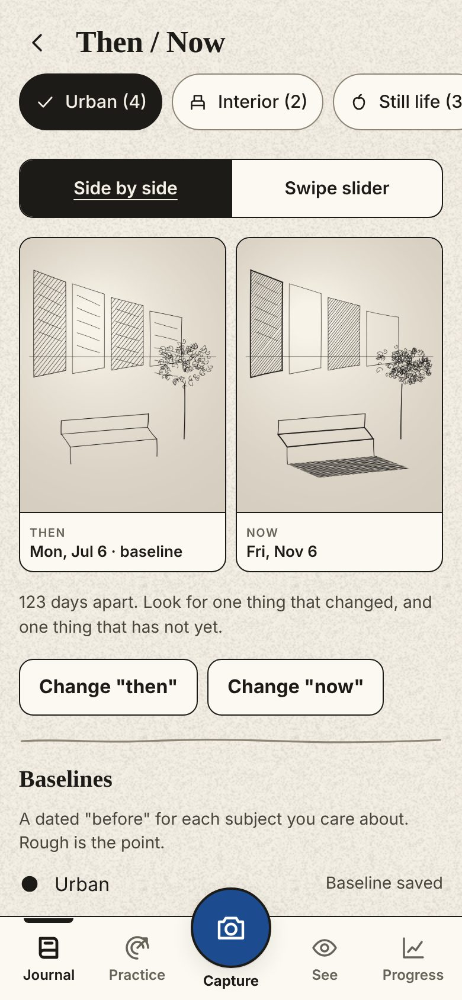 | 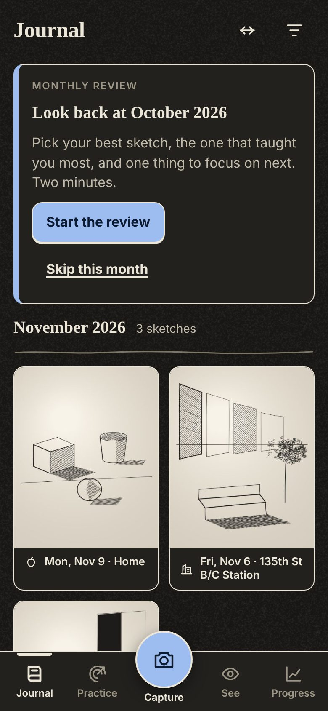 | 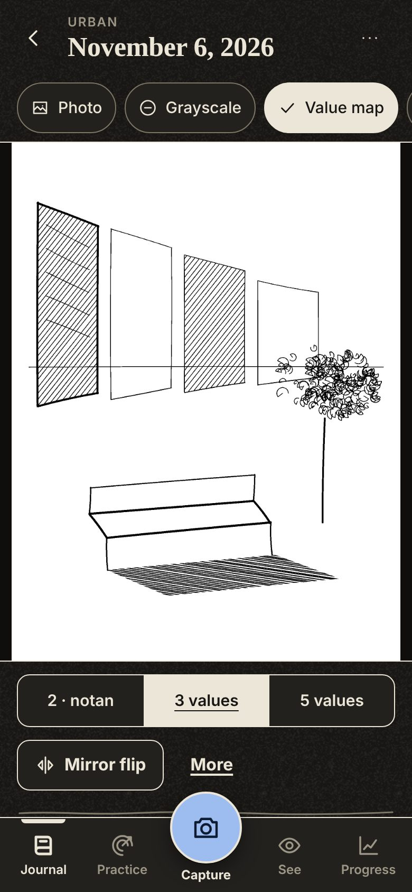 |

| Progress (dark) | Palette Lab (dark) | Practice (dark) | Reflection (dark) |
| --- | --- | --- | --- |
| 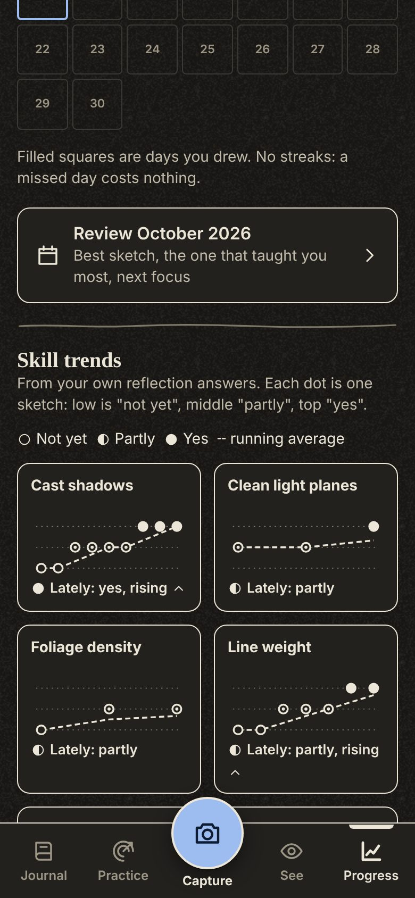 | 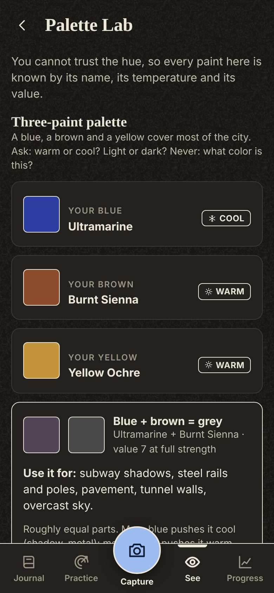 | 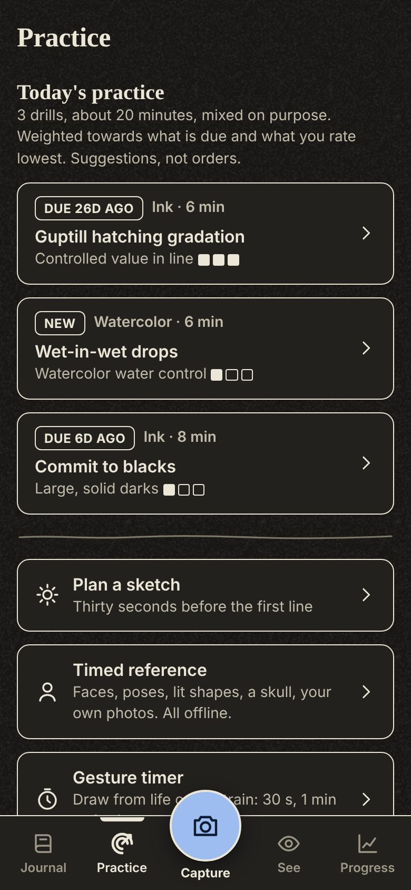 | 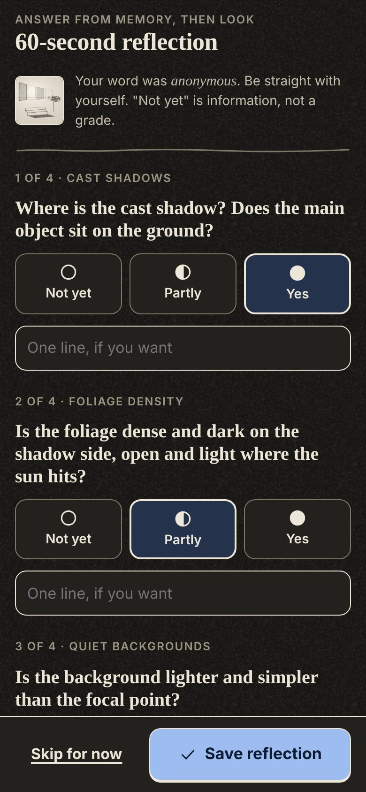 |

Every screenshot is generated by `npm run screenshots` at iPhone 14 size (390 × 844 pt) from the built app with demo data loaded. The sketches in them are drawn by code, not by a person.

## The live app

Once GitHub Pages is switched on (next section), every push to `main` deploys to:

```
https://<github-user>.github.io/<repository>/
```

For this repository that is **https://sfdg85nffw-hub.github.io/sketchapp/**

## Turn on GitHub Pages (once)

1. On GitHub, open the repository, then **Settings › Pages**.
2. Under **Build and deployment**, set **Source** to **GitHub Actions**.
3. Push to `main` (or open **Actions › CI and deploy › Run workflow**).
4. The workflow typechecks, lints, runs the unit tests, runs the end-to-end tests in WebKit and Chromium, builds, and deploys. The URL appears on the workflow run and under **Settings › Pages**.

Pages on a private repository needs a paid GitHub plan. On a free plan, make the repository public.

## Install it on the iPhone

1. On the iPhone, open the live URL in **Safari**. Safari is the dependable route for installing a web app on iOS.
2. Tap the **Share** button (the square with an arrow), scroll down, and tap **Add to Home Screen**.
3. Tap **Add**. An ink-nib icon called "Sketchbook" appears on the home screen.
4. Open it from the home screen. It runs full-screen. After this first launch it works with no signal, including underground.
5. The first time you open **See** and start the live view, iOS asks for camera access. Allow it.

Updates arrive on their own: when a new version has been deployed, the app picks it up the next time it is opened with a connection.

## Back up every two weeks

All data lives in Safari's storage on the phone. Nothing is uploaded anywhere. iOS can clear a web app's storage when space is short or the app has not been opened for a while, so a backup is the only safety net.

- **Progress › Settings and backup › Export everything (.zip)** opens the share sheet with one file: `data.json` plus every photo. Save it to Files or iCloud Drive.
- **Import from a backup file** on the same screen restores it. Importing merges: items in the file replace matching ones, and nothing else is removed.
- The Journal shows a quiet reminder once the last backup is two weeks old. "Remind me next week" postpones it.

## Develop

Requires Node 22.

```bash
npm install
npm run dev          # http://localhost:5173
npm run typecheck
npm run lint
npm test             # unit tests (Vitest)
npm run build        # production build into dist/, including the service worker
npm run build:artifact  # the claude.ai Artifact preview build, into dist-artifact/
npm run e2e          # Playwright, WebKit and Chromium at 390x844; needs: npx playwright install webkit chromium
npm run screenshots  # regenerate docs/screenshots (run npm run build first)
npm run simulate     # regenerate docs/palette-simulation-*.png and check contrast
npm run icons        # regenerate app icons and paper textures
```

The service worker is only registered in production builds, so `npm run dev` never serves stale files.

### Layout of the code

| Path | What is there |
| --- | --- |
| `src/lib/color/` | Pure colour maths: sRGB ↔ linear ↔ XYZ ↔ Lab, CIEDE2000, colour names, warm/cool, value 1–10, posterization, white balance, Machado CVD simulation, confusable pairs, paint matching |
| `src/lib/image/` | Pixel filters over plain arrays |
| `src/lib/` | Drill scheduler, practice proposal, reflection prompt choice, stats, backup zip, dates |
| `src/data/` | The ten weaknesses, drills, project templates, paints and recipes, materials notes |
| `src/db/` | IndexedDB stores, image storage, backup, demo data |
| `src/ui/` | Shared components: value tools, live camera, crop editor, kit |
| `src/screens/` | One file per screen |
| `src/workers/` | Web Worker for pixel work on photos |
| `tests/unit/` | Vitest |
| `e2e/` | Playwright |
| `scripts/` | Icon, fixture, screenshot and palette-simulation generators |

## Colorblind-safe by construction

The interface is ink on paper with one blue accent, and no state is ever carried by color alone. `npm run simulate` renders the palette through simulated deuteranopia and protanopia and fails if any text or control pair drops below its WCAG contrast ratio.

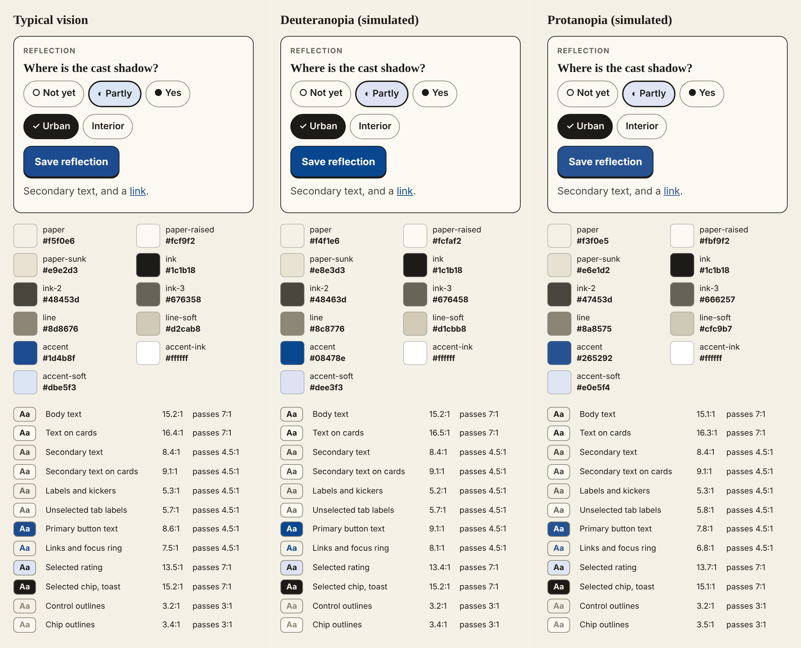

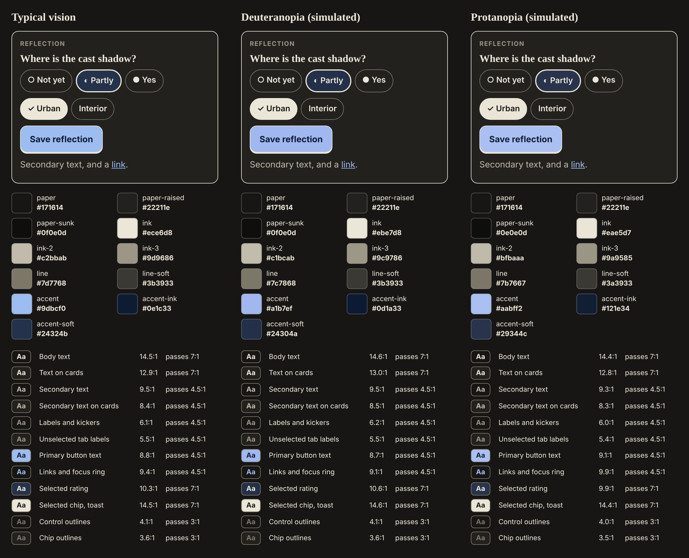

The same simulation applied to real screens:

| Reflection, deuteranopia | Reflection, protanopia | Progress, deuteranopia | Progress, protanopia |
| --- | --- | --- | --- |
| 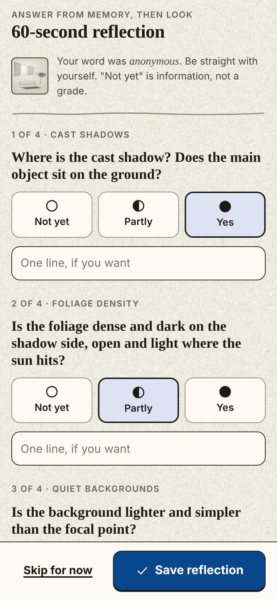 | 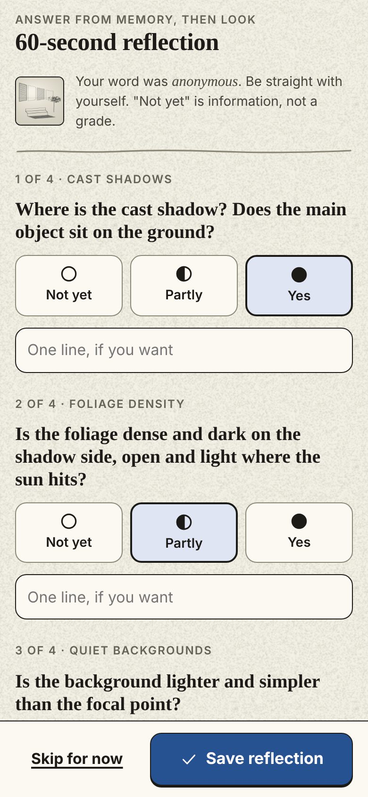 | 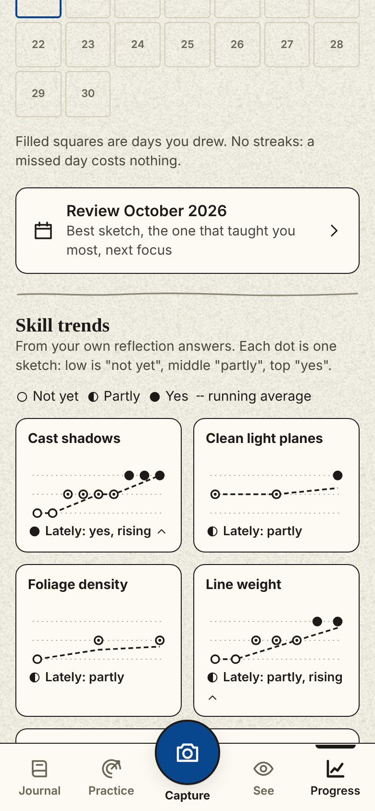 | 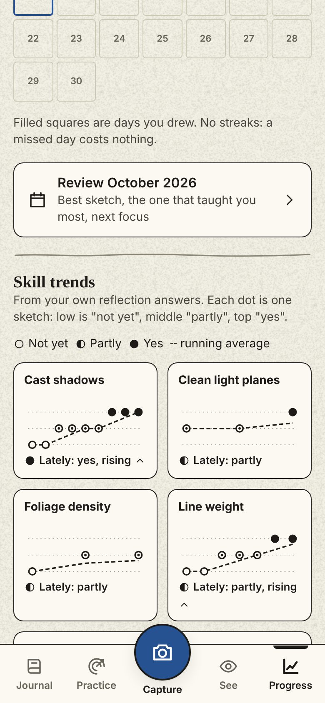 |

More in [DESIGN.md](DESIGN.md) (why the interface is the way it is) and [DECISIONS.md](DECISIONS.md) (every judgment call).
